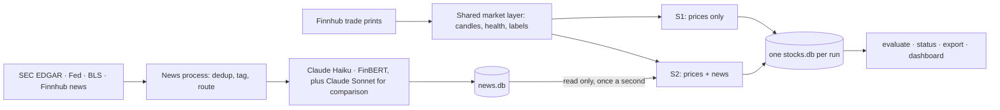

# BTC Survivor · Version 2: stocks and news

<p>
  
  
  
  
</p>

> **Does news, scored by a language model, predict the next 30 minutes of a stock's price? Two populations of online-learning networks paper trade seven large US tech stocks and the QQQ fund. They are identical except that one of them sees scored news. Paper trading only, with no order code anywhere.**

This is the version 2 branch, `feat/v2-stocks`. Version 1, six Bitcoin runs live since October 2026, is on the default branch, [`feat/initial-bot`](https://github.com/AtomicAyush/btc-survivor/tree/feat/initial-bot).

### Highlights
- **A controlled comparison.** Run S1 learns from 10 price features. Run S2 adds two news inputs per symbol, one for company news and one for macro news. Each S2 learner starts as an exact copy of its S1 counterpart, and the two make bitwise identical predictions until S2 first trains on news. Any later difference between the runs comes from news.
- **A live news pipeline.** Its sources are:
  - SEC EDGAR 8-K filings
  - Federal Reserve press releases and speeches
  - four BLS release feeds
  - Finnhub company and general news

  Each item is deduplicated and tagged with the symbols it names, or with MACRO. Claude Haiku scores every routed item, and FinBERT, a local model, scores the same items as the fallback and the baseline. The primary stream, which the test uses, takes Haiku's score, or FinBERT's where Haiku has none. Claude Sonnet scores the official items as a side comparison. One cap in code limits model spend to 20 dollars a month.
- **A test fixed before launch.**
  - H1 asks whether the news predictor correlates with the next 30-minute return.
  - Only if H1 passes, H2 asks whether news adds anything beyond the price features.
  - Both are one-sided at a 1 percent familywise level, over about 40 sessions.
  - The expected result, written before launch, is that H1 does not pass.
- **Built for a live market.** The system handles:
  - Finnhub's free trade feed: prints only, on a partial tape.
  - Price health for each symbol.
  - A market calendar through 2028.
  - Realistic costs: 3.6 to 6.6 bps a round trip.
  - Checkpoints and resume, and exact replay from recordings.
  - A dashboard that listens only on `127.0.0.1`.
- **About 18.6k lines of Python** in `btc_survivor.v2`, with 71 version 2 test files. Tests fail if any version 1 module or run config changes.



## Status, 15 October 2026

- **Rehearsal.** Version 2 is built and in rehearsal. Two sessions run the launch code live, the first on Thursday 15 October and the second on Friday 16 October, with kill, news restart, pause and cap drills. The pass rule is in [v2_operations.md](docs/v2_operations.md#rehearsal-and-drills).
- **Launch.** Runs S1 and S2 are scheduled to launch at the open on Monday 19 October 2026 if the rehearsal passes, otherwise at the first open after a passed rehearsal.
- **Window.** The window ends when S2 reaches 15,600 run minutes from launch, the length of 40 full sessions. A run minute is a session minute in which news health held and at least one symbol was healthy. If no minutes are lost, it ends on 15 December 2026, in session 41.
- **Version 1.** Its six Bitcoin runs keep running untouched. Version 2 changes no version 1 module, config or run.

## What it measures

**The confirmatory claim.** It is a fixed sequence of two tests:
- **H1** judges S2's `news` predictor, the company plus macro input from the primary score stream. The measure is its pooled correlation with each next 30-minute return over the eight symbols, with errors clustered by minute.
- **H2** runs only if H1 passes. It asks whether news carries information beyond price: the news predictor and the label are each residualised on the 10 stored price z-scores within each symbol, then judged the same way.

**Everything else is descriptive.** That covers S2 against S1, Haiku against FinBERT, and Sonnet against Haiku. It also covers a chooser scorecard (would picking the best-ranked symbol beat simple baselines after costs?) and a day scorecard (would a 10:00 call held to the 15:55 flatten beat holding long, a coin flip and staying flat, after costs?).

**The expected result.** Written before launch: H1 does not pass, because megacap prices absorb headlines within minutes and the pipeline adds delay.

**Power.** A synthetic power check puts the smallest correlation H1 can detect over 40 sessions at about 0.075 to 0.122, depending on how much of the news is shared macro news. The correlation the test finds in 90 percent of simulated runs is 0.081 to 0.151. The criteria, power figures and what a failure means are in [v2_evaluation.md](docs/v2_evaluation.md).

## The two runs

Both runs live in one stock process and share one market layer, so they see exactly the same candles, prices, health and labels.

**The learners.**
- **Numbers.** Each run has 24 learners and 24 coin-flip twins.
- **The network.** Each learner is a NumPy network with 12 inputs, 16 hidden units and 225 parameters.
- **Predicting and learning.** A learner predicts all eight symbols in every usable minute and learns from all eight.
- **Trading.** It trades only its home symbol, so three learners trade each symbol.
- **Twins.** Each twin trades at the same moments as its learner but picks its side by coin flip, so the gap between them measures skill rather than timing luck.
- **No evolution.** Version 2 has no evolution and no replacement.

**The trading rules.**
- **Size and horizon.** Each learner trades a fixed 500 dollars on a start equity of 10,000 dollars, with a 30 session-minute horizon and a stop at 3 label standard deviations.
- **Forced trades.** A learner makes a forced trade after 3 healthy session hours without one.
- **Hours.** Only the regular session counts.
  - Opens are allowed from `10:00` to `15:25` New York time.
  - Every open position closes from `15:55`.
  - No label ever spans a close.

**Costs.** A round trip costs:
- 3.6 bps for QQQ
- 4.6 bps for AAPL, MSFT, NVDA, AMZN and GOOGL
- 6.6 bps for META and TSLA

That is against about 190 bps for a version 1 retail Bitcoin round trip.

The runs and costs are set out in [v2_overview.md](docs/v2_overview.md).

## Running it

Version 2 uses its own Python 3.11 environment with the `test` and `v2news` extras. The stock process needs a Finnhub key. The news process needs that key, an Anthropic key, and a contact address for the SEC and BLS request headers. All three go in `~/.config/btc_survivor/secrets.env`, outside the repository, as [v2_data_and_licensing.md](docs/v2_data_and_licensing.md#secrets) explains. The news process also needs the FinBERT model, which is not in the repository: `scripts/export_finbert.py` exports it once, in a separate environment with torch, to the gitignored `data/models/finbert`, as [v2_news.md](docs/v2_news.md#finbert) explains. Without it, `news` exits with code 2. `news` and `stocks` run until stopped, so each needs its own terminal, or the `nohup` lines in [v2_operations.md](docs/v2_operations.md).

```bash
python3.11 -m venv .venv-v2
.venv-v2/bin/pip install -e ".[test,v2news]"
.venv-v2/bin/python -m pytest -q
.venv-v2/bin/btc_survivor_v2 check-secrets

.venv-v2/bin/btc_survivor_v2 init-db configs/v2/news.toml
.venv-v2/bin/btc_survivor_v2 news configs/v2/news.toml

.venv-v2/bin/btc_survivor_v2 init-db configs/v2/s1_prices.toml
.venv-v2/bin/btc_survivor_v2 init-db configs/v2/s2_news.toml
.venv-v2/bin/btc_survivor_v2 stocks configs/v2/s1_prices.toml configs/v2/s2_news.toml

.venv-v2/bin/btc_survivor_v2 status configs/v2/s1_prices.toml configs/v2/s2_news.toml
.venv-v2/bin/btc_survivor_v2 evaluate configs/v2/s1_prices.toml configs/v2/s2_news.toml
.venv-v2/bin/btc_survivor_v2 dashboard configs/v2/s1_prices.toml configs/v2/s2_news.toml   # 127.0.0.1:8060
```

Every command prints counts and verdicts by default, and rows only with `--detail`. Starting, stopping, drills and launch day are covered in [v2_operations.md](docs/v2_operations.md).

## Guides

* [PLAN_V2.md](PLAN_V2.md) is the approved design and every decision behind it.
* [v2_overview.md](docs/v2_overview.md) explains what version 2 does and why, from prices and news to the confirmatory test.
* [v2_data_and_licensing.md](docs/v2_data_and_licensing.md) covers the data sources, the cost and fill model, shorts, margin, secrets and licensing.
* [v2_news.md](docs/v2_news.md) covers news collection, the model and FinBERT scoring, spend controls and the score streams.
* [v2_evaluation.md](docs/v2_evaluation.md) covers the `evaluate` command, the criteria, the outcomes, the chooser and day scorecards, power, the planted news check and the learning rate.
* [v2_operations.md](docs/v2_operations.md) covers running the processes, the coverage report and stale thresholds, the rehearsal, the soak and the secret scan.
* [RESULTS_V2_TEMPLATE.md](docs/RESULTS_V2_TEMPLATE.md) is the empty template the results are written into after the window.

## Rules and honest limits

* **No real money and no orders.** There is no order placement code, and a test scans every file for broker names and order fields.
* **No lookahead.** A price counts from when this system received it, and a scored headline from when the stock process received its score.
* **No backtest tuning.** No backtest or replay chooses, tunes or ranks anything. Every setting is fixed before launch and never changes after it. Settings come from reasoning, synthetic checks, or rules written in advance, such as the stale limits taken from the gate session's recording.
* **No stale data.** Nothing trades or learns on stale prices or while the news pipeline is down.
* **Balanced books.** The books always balance, and a restart is not a death.
* **Skill, not profit.** Version 2 measures skill. Even a predictor that passes would not cover costs on most symbols at the correlations the window can detect.
* **Data limits.**
  - The free feed is a partial tape with no quotes.
  - Only the regular session is traded, so overnight reactions to earnings are invisible.
  - Every result rests on one set of scores from each model.
* **No stock data in this repository.** Finnhub's terms bar sharing its data, or anything derived from it, with a third party without written approval. So no stock data is committed or published, and there is no public page. Finnhub headlines do go to the Anthropic API for scoring, a risk the owner accepted, as [v2_data_and_licensing.md](docs/v2_data_and_licensing.md#the-owners-decision-on-finnhub-headlines) explains.

## License

BTC Survivor is released under the [MIT License](LICENSE).
